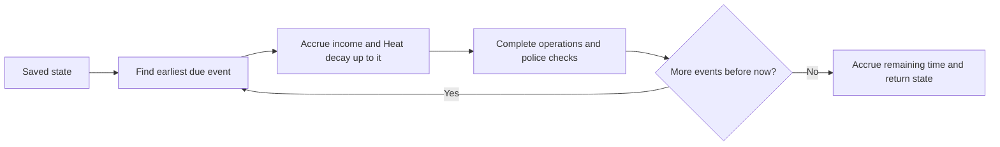

# 3. Timers and game rules

Goal: understand why a job finishes correctly even after closing the tab.

## Store a finish time

A fragile timer subtracts one every second. If the tab sleeps, callbacks are delayed and the countdown drifts. Instead, an `Operation` stores:

```ts
{ startedAt: now, endsAt: now + seconds * 1000 }
```

The display calculates `endsAt - now`. The interval in the store refreshes the display and checks for due events. It is not a counter that owns the operation's progress.

`countdown()` and `progress()` in `ui/format.ts` are presentation helpers. They never award resources.

## Resolve events in order

Suppose you start building a speakeasy at 12:00:00. It opens at 12:00:25. You come back at 12:01:25.

The engine must not pay 85 seconds of speakeasy income. It first accrues the old rate until 12:00:25, completes construction, then pays 60 seconds at the new rate. That is why `advanceGame()` works through event timestamps before finishing the remaining interval.



Income is capped by safehouse storage. Heat never falls below zero. Time resolution stops at `roundEndsAt`; no post-round earnings are created.

## Separate queues

One construction, one recruitment, one laundering batch, and one street operation may run at once. A job and laying low share the street slot. You can build while a runner collects money.

Assigned crew remains in the total roster but is subtracted by `availableCrew()`. Completion removes the operation, which makes the crew available again. There is no “return crew” increment that could run twice.

An available driver is attached automatically and reduces a job duration by 20%. Police arrest only an idle enforcer, so an assigned crew remains internally consistent.

## Police checks

At 70 or more Heat, the engine considers the next scheduled police check. If Heat is still at least 70 after decay and same-time completions, police seize 20% of dirty money and arrest one idle enforcer if possible. Heat drops by 30. The check interval is 60 seconds.

This prototype uses a deterministic rule so it is easy to learn and test. The PDF's random raid system is still part of the production plan. Random outcomes should be generated and persisted by the server, never rerolled by refreshing a client.

## Tests are examples you can run

Run `npm.cmd test`. The rule tests use Node's test runner and TypeScript stripping, with no Angular test environment needed. Each test supplies a known time rather than waiting in real time.

The tests cover construction costs, queues, offline chronology, crew reservation, laundering, police checks, bribes, storage, recruitment, and round closure. One compares a three-minute offline jump with 180 one-second updates.

## Try it

Add a test that starts with 100 Heat and zero enforcers. Advance to the next police check. Assert that the police report exists, the cash seizure is correct, and no crew count is negative.

Then change `laylowSeconds` in config and observe the countdown. Keep production balance separate from learning-friendly durations.
